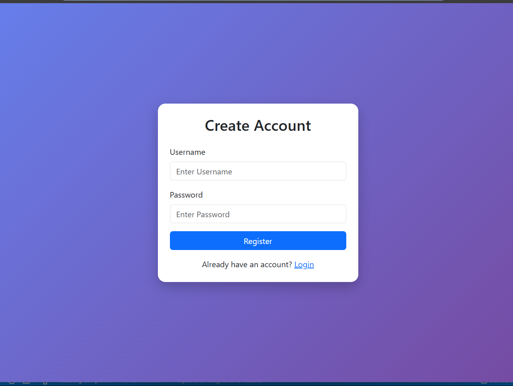
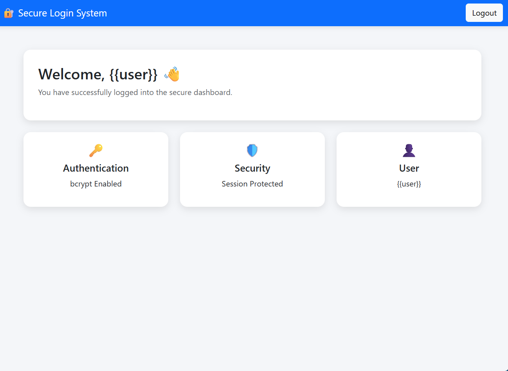

# 🔐 Secure Login System

A lightweight Flask authentication app with account registration, secure password hashing, CSRF-protected forms, session-based login, and a responsive dashboard. It uses SQLite for local user storage.

> **Learning project:** This repository is intended for learning and local demos. Review the deployment checklist before exposing it to the public internet.

## ✨ Features

- User registration and login
- bcrypt password hashing (no plaintext password storage)
- Parameterized SQLite queries
- Server-side username and password validation
- CSRF protection for form submissions
- Session clearing on login and logout
- HTTP-only, SameSite session cookies and a configurable Secure-cookie setting
- Responsive login, registration, and dashboard pages
- Password visibility toggle and client-side strength indicator
- Security response headers and user-friendly flash messages

## 🧰 Tech Stack

- Python 3.10+
- Flask
- Flask-WTF (CSRF protection)
- SQLite
- bcrypt
- HTML, CSS, Bootstrap, JavaScript

## 🖼️ Screenshots

### Registration


### Login


### Dashboard


## 📁 Project Structure

```text
Secure-Login-System/
├── app.py
├── requirements.txt
├── users.db                 # Created locally on first run; ignored by Git
├── templates/
│   ├── login.html
│   ├── register.html
│   └── dashboard.html
├── register_page.png
├── login page.png
├── dashboard.png
├── README.md
└── .gitignore
```

## 🚀 Run Locally

### 1. Clone the repository

```powershell
git clone https://github.com/shivarjunchaturvedi/Secure-Login-System.git
cd Secure-Login-System
```

### 2. Create and activate a virtual environment (recommended)

```powershell
python -m venv .venv
.\.venv\Scripts\Activate.ps1
```

If PowerShell blocks activation, you can call the environment's Python directly with `.venv\Scripts\python.exe`.

### 3. Install dependencies

```powershell
python -m pip install -r requirements.txt
```

### 4. Set a session secret and run

Generate a strong secret for your local terminal session:

```powershell
$env:SECRET_KEY = python -c "import secrets; print(secrets.token_hex(32))"
python app.py
```

Then open [http://127.0.0.1:5000](http://127.0.0.1:5000).

The app creates `users.db` automatically when it starts. The database is local and should not be committed.

## 🔒 Security Notes

- Passwords are hashed using bcrypt with a per-password salt.
- SQL statements use parameters rather than string concatenation.
- Registration and login validate input on the server; the browser's validation is only a convenience.
- Flask-WTF CSRF protection is enabled on state-changing form submissions.
- Login clears the previous session before setting the authenticated user.
- Logout uses a POST form so it is protected by CSRF.
- The default session key is temporary if `SECRET_KEY` is not set. Set a persistent, random `SECRET_KEY` for any deployment.
- Set `COOKIE_SECURE=1` only when serving over HTTPS. Do not use Flask's development server for production.

## ✅ Manual Test Checklist

1. Register a username that meets the rules and a password of at least 8 characters.
2. Try a duplicate username; the app should show a useful message.
3. Sign in using the correct credentials and confirm the dashboard appears.
4. Try an incorrect password and confirm the error does not reveal whether the username exists.
5. Open `/dashboard` in a private/incognito window; it should redirect to login.
6. Log out, then open the dashboard again; it should redirect to login.
7. Check that a direct POST without a CSRF token is rejected.

## ⚠️ Limitations

- This is a small demonstration app, not a fully audited identity platform.
- It does not include email verification, password reset, login rate limiting, MFA, or account lockout.
- Use HTTPS, a persistent secret key, rate limiting, monitoring, and a production WSGI server before deployment.
- Back up the SQLite database securely if using it for anything beyond a local demo.

## 👨‍💻 Author

**Shivarjun Chaturvedi**

- GitHub: [@shivarjunchaturvedi](https://github.com/shivarjunchaturvedi)
- LinkedIn: [Shivarjun Chaturvedi](https://www.linkedin.com/in/shivarjun-chaturvedi)
